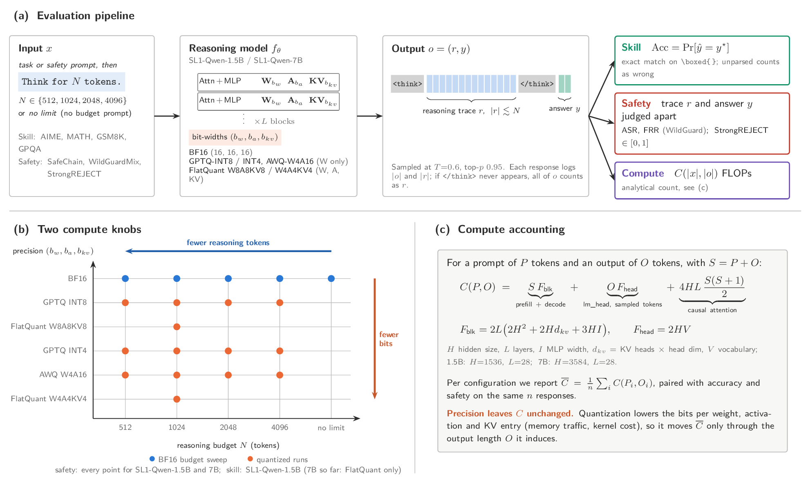

# adaptive-compute



Studies how constraining a reasoning model's "thinking" token budget affects
safety behavior and task skill. Reasoning models (e.g. L1-Qwen, DeepScaleR,
DeepSeek-R1-Distill) are prompted with `Think for N tokens.` at varying
budgets, and evaluated two ways:

- **Safety**: responses to harmful/benign prompts from
  [UWNSL/SafeChain](https://huggingface.co/datasets/UWNSL/SafeChain) or
  [allenai/wildguardmix](https://huggingface.co/datasets/allenai/wildguardmix)
  (WildGuardTest split) are scored with
  [WildGuard](https://github.com/allenai/wildguard) for attack success rate,
  refusal rate, and false refusal rate.
- **Skill**: responses to math/science/reasoning benchmarks (AIME, GPQA,
  LSAT) are scored by exact-matching the model's extracted final answer
  against each dataset's gold label — so budget-vs-safety tradeoffs can be
  read against budget-vs-capability tradeoffs.

Separately, the repo also studies how **post-training quantization**
(GPTQ weight-only int8/int4/int3, and W8A8/W4A8 weight-activation) affects
the same safety/skill metrics, to see whether compute savings from budget
constraints and from quantization compose.

## Layout

- `eval/eval_safety.py` — two-stage generate/evaluate script for the safety
  benchmarks (SafeChain / WildGuardMix). Generates responses with vLLM and
  saves them to a parquet file, then (separately) runs WildGuard
  classification and computes safety metrics.
- `eval/eval_skill.py` — two-stage generate/evaluate script for the skill
  benchmarks (AIME, GPQA, LSAT). Same parquet-based two-stage flow as
  `eval_safety.py`, but scores against each dataset's own gold answer
  instead of calling WildGuard.
- `eval/sweep_budget.py` — runs `eval_safety.py` across a list of token
  budgets, aggregates results into an Excel summary and a plot.
- `eval/sweep_quantization.py` — compares a base (BF16) model against its
  quantized variants (int8/int4/int3 GPTQ, W8A8/W4A8) on a safety dataset,
  either against pre-built checkpoints or by quantizing them itself via
  `--quantize`.
- `utils/dataset_utils.py` — shared SafeChain / WildGuardMix loaders used by
  both `eval/eval_safety.py` and the `quantize/` calibration-data scripts.
- `quantize/quantize_model.py` — post-training GPTQ weight-only quantization
  (int8/int4/int3) of a base checkpoint via `gptqmodel`, calibrated on
  SafeChain/WildGuardMix prompts. Produces a checkpoint `eval_safety.py` /
  `eval_skill.py` can load directly via `--model-id` (vLLM auto-detects
  GPTQ from `quantize_config.json`).
- `quantize/quantize_model_activation.py` — post-training weight-activation
  quantization (W8A8, W4A8) via `llmcompressor`, producing a
  compressed-tensors checkpoint vLLM loads natively (no extra flags).
- `quantize/KNOWN_ISSUES.md` — write-up of a `gptqmodel` GPTQ quantization
  failure on Intel XPU (Aurora); GPTQ int8/int4/int3 is CUDA-only for now,
  W8A8/W4A8 via `llmcompressor` is the untested fallback path there.
- `plots/` — standalone plotting/report scripts.
- `scripts/jobs/` — PBS (`qsub`) job scripts for running sweeps on the ALCF
  Polaris (CUDA) cluster; `*_aurora.sh` variants target the ALCF Aurora
  (Intel XPU) cluster.
- `scripts/install_xpu_env.sh`, `scripts/eval_xpu_model.sh` — environment
  setup and eval entrypoint for the Aurora/XPU path.

## Setup

Install dependencies (see [requirements.md](requirements.md), or
[requirements-xpu.md](requirements-xpu.md) for the Aurora/Intel XPU
environment):

```bash
pip install -r requirements.md
```

The `wildguard` dependency is installed from a local editable path
(`file:///../wildguard`), so a `wildguard/` checkout must exist as a sibling
of this directory (i.e. inside the parent `safety-eval/` repo).

## Running

### Safety evaluation

Run generation and evaluation in one go:

```bash
cd eval
python eval_safety.py --dataset safechain --n 100 --max-tokens 2048
```

Or split into two stages (useful since generation needs a GPU but WildGuard
scoring doesn't):

```bash
# Stage 1: generate responses, save to parquet
python eval_safety.py --generate --dataset wildguard --n 100 \
  --max-tokens 2048 --parquet generations.parquet

# Stage 2: run WildGuard on the saved parquet
python eval_safety.py --evaluate --parquet generations.parquet \
  --output results.json
```

Use `--think-budget N` to constrain reasoning to `N` tokens, `--model-id` to
evaluate a different model (default: `l3lab/L1-Qwen-1.5B-Exact`), and
`--dataset {safechain,wildguard}` to pick the benchmark. On a multi-GPU
node, `--tensor-parallel-size` shards one model replica across GPUs (default
4), and `--num-dp-workers` runs multiple replicas in parallel, sharding the
dataset across them (needs `num-dp-workers * tensor-parallel-size` GPUs).

### Skill evaluation

Same two-stage flow, against AIME / GPQA / LSAT instead of SafeChain /
WildGuardMix:

```bash
cd eval
python eval_skill.py --dataset gpqa --n 100 --max-tokens 4096

# or split into stages:
python eval_skill.py --generate --dataset aime --n 100 \
  --max-tokens 32768 --think-budget 2048 --parquet generations.parquet
python eval_skill.py --evaluate --parquet generations.parquet \
  --output results.json
```

`--dataset` accepts `aime`, `gpqa`, or `lsat`; all other flags
(`--think-budget`, `--model-id`, `--tensor-parallel-size`,
`--num-dp-workers`, etc.) match `eval_safety.py`. Scoring is local
exact-match against each dataset's gold answer — no WildGuard/external
evaluator model is used.

### Budget sweep

Sweep several token budgets and produce a summary Excel file plus plots:

```bash
cd eval
python sweep_budget.py --dataset safechain --n 500 \
  --budgets 256 512 1024 2048 4096
```

Add `--no-baseline` to skip the unconstrained (no budget) run, or
`--evaluate-only` to re-score existing parquets in `--out-dir` without
regenerating.

### Quantization

Produce a GPTQ weight-only checkpoint (int8/int4/int3):

```bash
cd quantize
python quantize_model.py --model-id l3lab/L1-Qwen-1.5B-Exact --bits 4 \
  --calib-dataset safechain --calib-samples 256 \
  --output-dir ./checkpoints/L1-Qwen-1.5B-Exact-gptq-int4
```

Or a weight-activation checkpoint (W8A8/W4A8) via `llmcompressor`:

```bash
cd quantize
python quantize_model_activation.py --model-id l3lab/L1-Qwen-1.5B-Exact \
  --scheme W8A8 --calib-dataset safechain --calib-samples 256 \
  --output-dir ./checkpoints/L1-Qwen-1.5B-Exact-w8a8
```

Either checkpoint directory can then be passed directly as `--model-id` to
`eval_safety.py` / `eval_skill.py` — vLLM auto-detects the quantization
format from the checkpoint's config. `--calib-dataset` accepts
`{safechain,wildguard}`, matching the safety datasets, since calibration
prompts are drawn from the same distribution used for evaluation.

To compare a base model against several quantized variants in one run, use
`eval/sweep_quantization.py`, either against pre-built checkpoints:

```bash
cd eval
python sweep_quantization.py \
  --bf16-model-id l3lab/L1-Qwen-1.5B-Exact \
  --int8-model-id ../quantize/checkpoints/L1-Qwen-1.5B-Exact-gptq-int8 \
  --int4-model-id ../quantize/checkpoints/L1-Qwen-1.5B-Exact-gptq-int4 \
  --dataset safechain --n 500
```

or letting it quantize on the fly with `--quantize int8 int4 int3 w8a8 w4a8`
instead of passing pre-built checkpoint paths.

**Note:** GPTQ (`quantize_model.py`) currently fails on Aurora's Intel XPU
nodes due to an upstream `gptqmodel`/XPU incompatibility — see
[quantize/KNOWN_ISSUES.md](quantize/KNOWN_ISSUES.md) for the full debugging
trail. It works on CUDA (e.g. Polaris). `quantize_model_activation.py`
(`llmcompressor`) is the untested fallback for weight-activation
quantization on XPU.

### Cluster (PBS) jobs

`scripts/jobs/` contains per-model, per-dataset PBS job scripts. Most target
the ALCF Polaris (CUDA) cluster (hardcoded cluster paths and modules — not
runnable locally); files suffixed `_aurora.sh` target the ALCF Aurora
(Intel XPU) cluster instead. Submit all sweeps at once with:

```bash
bash scripts/jobs/submit_all.sh            # SafeChain
bash scripts/jobs/submit_all_wildguard.sh  # WildGuardMix
```

## Requirements

See [requirements.md](requirements.md) for pinned Python dependencies on
CUDA clusters, or [requirements-xpu.md](requirements-xpu.md) for the
Aurora/Intel XPU environment.
